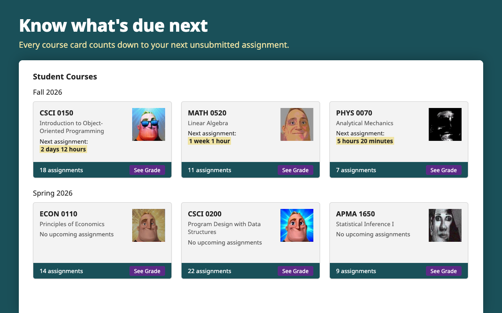
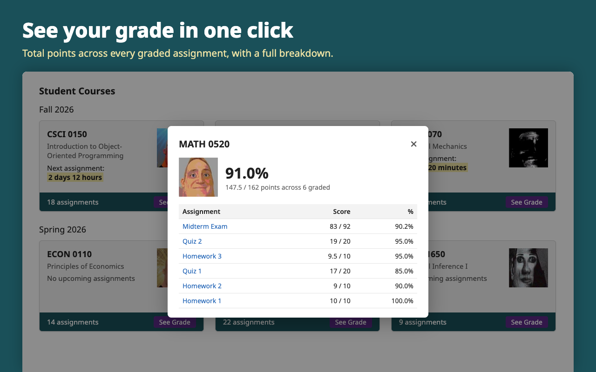
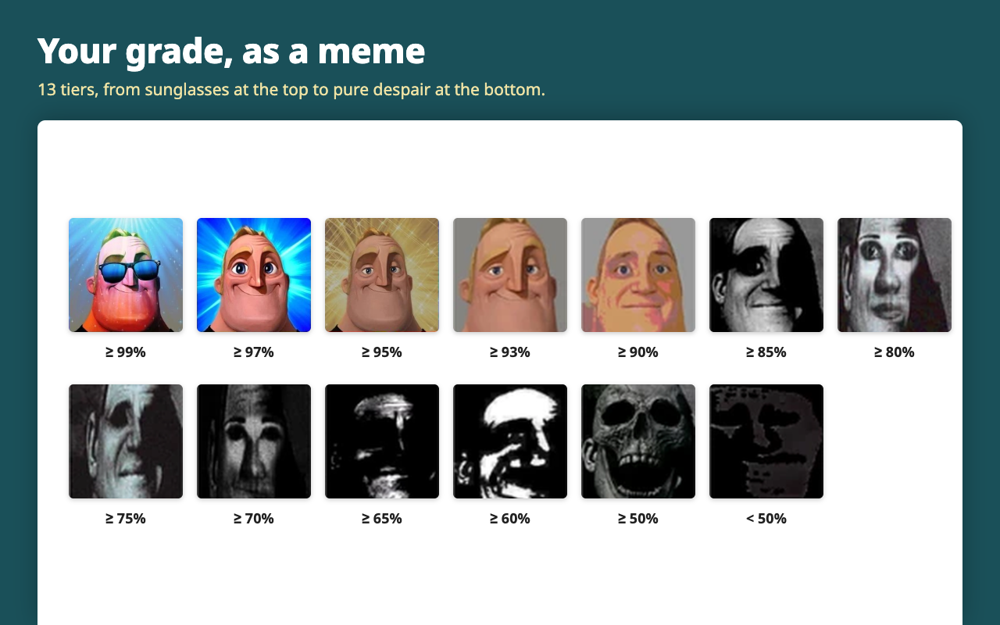

# Gradescope+

Chrome extension that adds to each **Student Courses** card on the Gradescope dashboard:

- **Next assignment:** countdown to the earliest unsubmitted assignment that is not yet past its regular due date.
- A "Mr. Incredible becoming uncanny" meme picked from your grade (total points earned / possible across graded assignments).
- A **See Grade** button that opens a per-assignment score breakdown.
- Optional **category weights** per course, set from the See Grade window (see below).

Course pages are fetched in the background and cached for 10 minutes. Countdowns refresh every minute.

   
   
  

## Install

Install from the [Chrome Web Store](https://chromewebstore.google.com/detail/gradescope+/mjkmoobnhoggnmcaicplhbdfoakdcnkh), or load it unpacked:

1. Open `chrome://extensions` and turn on **Developer mode**.
2. Click **Load unpacked** and select this folder.
3. Disable the old grade/next-assignment extension so the two don't both draw on the cards.

## Publish

Bump `version` in `manifest.json`, run `scripts/package.sh`, and upload the zip from `dist/` in the [Chrome Web Store developer dashboard](https://chrome.google.com/webstore/devconsole). Listing text and privacy answers are in `store/`.

## Layout

| Path | Contents |
|------|----------|
| `manifest.json`, `content.js`, `content.css` | The extension |
| `syllabus.js` | Syllabus grading-section parser, loaded before `content.js` |
| `tests/` | Parser tests: `node --test tests/syllabus.test.js` |
| `tests/corpus/` | Real-syllabus scoreboard: `scripts/fetch-corpus.sh`, then `scripts/score-corpus.sh` |
| `images/` | Grade meme tiers |
| `icons/` | Extension icons |
| `store/` | Web Store listing text, privacy policy, store icon |
| `store/src/`, `store/images/` | HTML sources and rendered store screenshots and promo tiles |
| `scripts/package.sh` | Builds the upload zip into `dist/` |
| `scripts/render-store-images.sh` | Renders `store/src/` into `store/images/` with headless Chrome |

## Category weights

In the See Grade window, **Set category weights** opens an editor for the weights in the course syllabus.

- **Paste from syllabus**: paste the grading section or the whole syllabus page. Tables are read from the clipboard's HTML copy (or tab-separated lines): the weight column is the one whose cells start with a weight, the names come from the most distinct column of short text, and other columns are only read for drop/best notes. Otherwise it reads lines and sentences ("Homework 30%", "30% homework", "Midterm Exams 2 × 15% = 30%", "Homework is worth 15% of your grade", PDF copies). On a whole page, the grading section is the run of consecutive weights that adds up to 100%; penalties and thresholds ("10% off per day late", "at least 60% to pass"), grading scales, totals and extra credit are skipped. Whichever reading totals 100% with the fewest doubtful rows wins. `syllabus.js` reads it on the computer, with no network. The preview shows categories, weights, the assignments each one finds and the ones none of them would find, before anything changes; the assignment list and Save step aside while it is open. When the reading is in doubt (the total isn't 100%, another part also adds up to 100%, a weight next to the breakdown was left out, or points have no stated total), it says so above the table. Each row has a checkbox, a weight left out next to the breakdown is offered unticked, and a category stated with its parts ("Exams 65%, with the midterm 40% and the final 25%") can be split into them. Point totals are converted to percentages. Ranges use the low end, with a warning. A drop rule with a count ("drop lowest 2", "lowest two dropped", "best 5 of 7") fills in that category's Drop lowest, when it is on the category's own line or a later sentence names the category's kind of work ("Your lowest homework score is dropped"). Other drop/best/whichever rules are listed as "Not applied". Applying replaces the categories, with Undo. A category with the same name as an existing one keeps its words and manual picks.
- On first open, categories are suggested from assignment names: names that share the words before their first number ("Problem Set 3", "HW2 - Auth", "LE3-Attempt 1") form a category, and one-off names add a category for a known kind (midterm, quiz, final exam).
- **Copy a prompt for an AI chat** (in the paste panel): copies a prompt, with the course's assignment names, that asks an AI chat to rewrite a pasted syllabus as `Category: weight% (drop lowest N)` lines. The reply pasted back is read like any other paste. The extension sends nothing; the reader takes the prompt to a chat of their choice.
- Each category has a name, comma-separated "Matches names with" words, a weight, "Drop lowest" (how many of the lowest scores so far are left out, by percentage, always keeping one), and "Counts by" (points earned / possible, or each assignment equal). When the words are empty, the category name and its synonyms are used: homework/hw/problem set/pset/assignment, quiz, lab, project, midterm/prelim, final/final exam, exam/test, participation/attendance/clicker. The placeholder shows the words in use.
- Words match whole words, case-insensitive, plurals included. The word that starts earliest in a name wins, so "Final Exam" goes to "Final" before "Exam", and "LE" doesn't match "Problem".
- Assignments are listed under their categories, with a "N of M sorted by name · K set by hand" summary. Changing an assignment's category moves it there; **auto** undoes a manual choice; each group's own select, in the same column as the rows' and showing the group's category, moves the whole group. Moving all of "Not counted" when the names share a start ("Prelab 6", "Prelab 7") adds that word to the category, so later ones are sorted there too.
- The grade averages only the categories that have graded work, with their weights rescaled to sum to 100%. Assignments in no category are listed as "Not counted".
- Weights are saved per course in `chrome.storage.local` under `weights:<courseId>`, separate from the fetch cache. The card meme uses the weighted grade once weights are set.

## Grade tiers

Edit `GRADE_TIERS` in `content.js`. Images are `images/tier1.png` (best) to `images/tier13.png` (worst).

| Grade | Tier | Image |
|-------|------|-------|
| ≥ 99% | tier1 |  |
| ≥ 97% | tier2 |  |
| ≥ 95% | tier3 |  |
| ≥ 93% | tier4 |  |
| ≥ 90% | tier5 |  |
| ≥ 85% | tier6 |  |
| ≥ 80% | tier7 |  |
| ≥ 75% | tier8 |  |
| ≥ 70% | tier9 |  |
| ≥ 65% | tier10 |  |
| ≥ 60% | tier11 |  |
| ≥ 50% | tier12 |  |
| < 50% | tier13 |  |

Courses with no graded work show tier4 (the neutral face).
